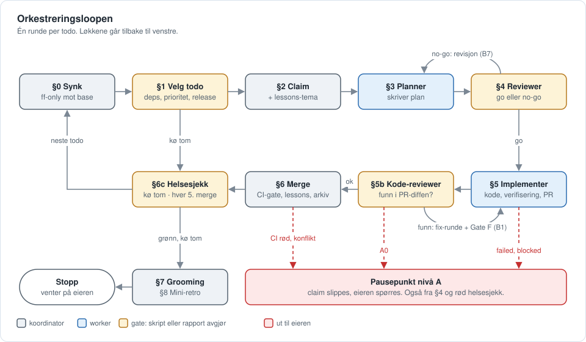
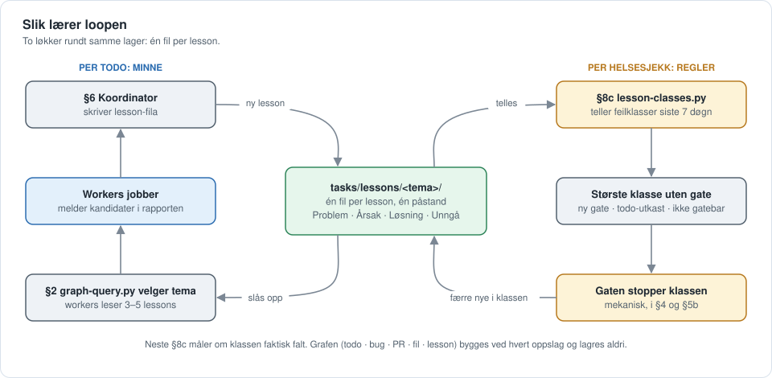

# v3-copilot — agent-orchestrator for GitHub Copilot

Et **parameterisert, selvstendig template** av en autonom orkestreringsloop for **GitHub Copilot**
(VS Code med Session Target = Copilot, eller Copilot CLI): en koordinator-agent kjører en kø av
todos gjennom planlegging → uavhengig review → implementering → uavhengig kode-review → merge, uten
at du trigger hvert steg. Loopen er destillert fra et live-prosjekt og gjort prosjekt-agnostisk via
`loop.config.yaml` + `/setup`. Funksjonsnivået er **v3.7**.

> Arkitektur: [`docs/ARCHITECTURE.md`](docs/ARCHITECTURE.md). Hvorfor kitet er bygget slik det er på
> Copilot: [`docs/PORTING-DECISIONS.md`](docs/PORTING-DECISIONS.md). Eksisterende prosjekt:
> [`MIGRATION.md`](MIGRATION.md).

---

## Slik fungerer loopen

Kitet er en løkke rundt en kø av todo-filer. Én **koordinator** (Copilot-sesjonen som kjører
`/run-loop`) velger neste todo og sender den gjennom fire kortlevde **workers**, som hver jobber i sin
egen git-worktree (laget av koordinatoren med `scripts/bootstrap-worktree.sh`) og svarer med en kort rapport. Koordinatoren er den eneste som skriver delt state
(lessons, arkiv, logger) og den eneste som merger.

| Rolle | Agent | Gjør | Skriver |
|---|---|---|---|
| Koordinator | koordinator-sesjonen | velger todo, dispatcher, gater på rapportene, merger | delt state, base-branchen |
| Planner | `<prosjekt>-planner` | skriver plan med verifiseringsblokk | planfila |
| Reviewer | `<prosjekt>-reviewer` | uavhengig plan-review: `go` eller `no-go` | ingenting (ingen `edit` i verktøylista, kontrollert av `readonly-check.sh`) |
| Implementer | `<prosjekt>-implementer` | koder, verifiserer, åpner PR | feature-branch |
| Kode-reviewer | `<prosjekt>-code-reviewer` | uavhengig review av PR-diffen | ingenting (ingen `edit` i verktøylista, kontrollert av `readonly-check.sh`) |

Boksene er steg i `coordinator-runbook.md`. Gule bokser er gater, der et skript eller en rapport
avgjør neste kant. Røde, stiplede kanter går ut til eieren.



**Løkkene i grafen:**

- **Ytre løkke** (§0 → §6 → §0): én runde per todo, til køen er tom eller et pausepunkt slår inn.
- **Planløkka** (§3 ⇄ §4): `no-go` sender planen tilbake til planneren. Fra runde 2 må gate-funnene
  gå ned, ellers blir det nivå A.
- **Fix-løkka** (§5b → fix-mode → Gate F → §5b): funn går tilbake til implementeren, og Gate F kjører
  planens verifiseringsblokk på nytt før neste review-runde.
- **Helseløkka** (§6c): `/loop-health-check` kjører når køen er tom og etter hver femte merge. Grønn
  sjekk slipper retro-forslagene og tallene videre (§8b, §8c). Rød sjekk stopper loopen.
- **Ikke tegnet:** fast-path (§2b) hopper fra §2 rett til §5 når planen alt er godkjent. §5c og §5d
  kjører planlegging eller implementering av neste todo samtidig med §5.

**Hvem avgjør i gatene:** `tasks/decision-level.py` klassifiserer hvert valg. Nivå B (B1–B7)
avgjør koordinatoren selv, logger i `decision-log.md`, og eieren kan vetoe etterpå. Nivå A (A0–A8)
stopper loopen og spør eieren. A0 er fail-closed: et valg skriptet ikke kan klassifisere, blir aldri
nivå B. Kostnadsbremsen (`tasks/measure-cost.py --brake`) kjøres foran §4- og §5b-gaten.

| Gate i grafen | Avgjøres av |
|---|---|
| §1 kvalifisert todo | `tasks/release.py status` og kø-skriptet i `steps/1-koe-utvelgelse.md` |
| §4 go / no-go | reviewerens `verdict`, `tasks/vblock-lint.py`, `decision-level.py --event plan_review_choice` |
| §5b funn | `review-lens-select.py`, `review-severity-floor.py`, `decision-level.py --event revise_gate_choice` |
| Gate F | `tasks/gate-f.sh` |
| §5d fil-disjunkt | `tasks/parallel-disjoint.py` |
| §6 merge | `tasks/ci-gate.py`, `scripts/check-todo-nr-premerge.sh`, hooken `guard-main-merge.sh` |
| Hver 5. merge | `tasks/loop-cadence.py` |
| §6c helsesjekk | `/loop-health-check` (Del A–D) |

### Selvlærende: atomiske lessons

Loopen lærer av seg selv på to måter. Begge bygger på at en lesson er **atomisk**: én fil per lesson
under `tasks/lessons/<tema>/<dato>-<slug>.md`, med én påstand om kodebasen, plattformen eller
verktøyet. Fila har `**Problem:**`, `**Årsak:**`, `**Løsning:**` og `**Unngå:**`, og frontmatter med
`tags` og `kilder` (`TODO-NN`, `BUG-NNN`). Det finnes ingen indeks og ingen telling som kan bli
utdatert. Filsystemet er indeksen.



- **Rask løkke, per todo (minne):** workers skriver aldri lessons selv. De melder kandidater i
  rapporten, og koordinatoren skriver filene i §6. Før neste todo slår §2 opp i kantgrafen
  (`python3 tasks/graph-query.py --todo <nr>` og `--file <sti>`), som viser hvilke lessons, bugs og
  tidligere todoer som henger sammen med filene todoen rører. Koordinatoren velger 1–3 tema, og
  workeren leser de 3–5 relevante filene, aldri en hel mappe. Atomiske filer er det som gjør dette
  mulig: en lesson kan hentes alene, uten å lese resten av temaet.
- **Treg løkke, per helsesjekk (regler):** §8c teller hvilke feilklasser lessons fra de siste sju
  døgnene faller i. Den høyest rangerte klassen uten mekanisk gate må få ett av tre utfall: ny gate
  nå, todo-utkast, eller «ikke gatebar» med grunn. «Ingenting skjedde» er ikke lov. En feil som
  gjentar seg, går dermed fra å være noe agentene må huske, til å være noe et skript stopper. Neste
  §8c måler om klassen faktisk falt.

Grafen bygges ved hvert oppslag og lagres aldri (`tasks/graph.json` sjekkes ikke inn). Klassene og
gatene i `lesson-classes.py` er eksempler og må tilpasses etter noen runder.
Lessons er én av tre kunnskapsbaser. De to andre er brukerminnet (samarbeidspreferanser) og
agent-minnet (arbeidsmetode per rolle), se `docs/loop-rules.md` § «Tre kunnskapsbaser».

Operatørens utgave av det samme står i `docs/orchestration-loop.md` i det installerte prosjektet.
Hvert steg har sin egen fil under `docs/loop/steps/`.

---

---

## Slik bruker kitet Copilot

| Behov i loopen | Copilot-mekanisme |
|---|---|
| Rolleagenter | Custom agents i `.github/agents/<prosjekt>-*.agent.md` med `tools`, `model` (prioritert liste), `user-invocable: false` og `include-custom-instructions: true` |
| Dispatch | `task`-verktøyet med `agent_type`, `model`, valgfri `reasoning_effort` og `mode` (`sync` eller `background` + `read_agent`) |
| Isolasjon | Koordinatoren lager én git-worktree per worker (`scripts/bootstrap-worktree.sh`) og sender stien i prompten. Subagenter deler ellers filsystem med koordinatoren |
| Read-only-roller | Ingen `edit` i verktøylista (håndhevet av Copilot) + `scripts/readonly-check.sh` etter hver dispatch |
| Vakter | Copilot-hooks i `.github/hooks/loop-guards.json`, generert av `/setup` |
| Kommandoer | Skills i `.github/skills/<navn>/SKILL.md`, kjørt som `/<navn>` |
| Prosjektregler | `AGENTS.md`, som peker til generert `docs/loop-rules.md` |
| Kostnad | AI credits fra `assistant.usage` i sesjonsloggen eller `/usage`; ellers `IKKE MÅLT` |

Begrunnelser og kilder: [`docs/PORTING-DECISIONS.md`](docs/PORTING-DECISIONS.md).

### Modeller

`loop.config.yaml` sier hva hver rolle krever, ikke hvilket merke den skal bruke. Eksempelfila har
plassholdere, og `/setup` stopper til alle er byttet ut:

| Rolle | Krever | Plassholder |
|---|---|---|
| planner, reviewer, code-reviewer | lange resonnement, finne feil i andres arbeid | `<DYP_MODELL>` |
| implementer | følge en godkjent plan med mange verktøykall | `<KODE_MODELL>` |
| scout (valgfri) | bare finne filer og symboler | `<BILLIG_MODELL>` |

- Bruk eksakte navn fra Copilots modellvelger. Hver rolle tar en liste: Copilot bruker den første som
  er tilgjengelig, så en reserve fra en annen leverandør gjør loopen robust mot policy-endringer.
- La gjerne reviewer og code-reviewer bruke en **annen modellfamilie** enn planner og implementer.
  Den uavhengige reviewen fanger mer når den ikke deler blindsoner med arbeidet den gransker.
- `<rolle>_effort` (`low`, `medium`, `high`, `xhigh`) er valgfri og sendes som `reasoning_effort`.
- `guard-fix-round-model.sh` krever at implementer-dispatchen bærer modellen fra config, og en dyp
  modell fra fix-runde 3.

---

## Org-modus (organisasjonens agentstandard)

Krever organisasjonen en felles `AGENTS.md`-standard med menneske-i-loopen, slå på `compliance` i
`loop.config.yaml`:

1. Legg organisasjonens standard **uendret** i prosjektet, f.eks. `docs/org/AGENTS.org.md`, og pek
   `compliance.org_instructions` dit.
2. Sett `data_classification`, `approved_mcp_servers` (navnene i `.mcp.json` som org-registeret har
   godkjent) og `high_risk_paths`.
3. Kjør `/setup`. Standarden settes inn øverst i `AGENTS.md` og går foran kitets regler; den byttes ut
   hver gang `/setup` kjøres, så endringer gjøres i org-fila.

Da gjelder dette i loopen (detaljer i `docs/loop/compliance.md`, som genereres):
- **Eieren godkjenner planen** (etter plan-review, før koding) og **mergen** (før noe når felles kode
  eller delt state committes), med faste spørsmål og bare et klart «Ja/Godkjent/Kjør» som svar.
- Agentene skriver bare i egne worktrees og branches før det.
- **Høyrisiko avvises:** infrastruktur, IAM/RBAC og hemmeligheter, både som kommando (hook) og som
  filer i plan eller PR.
- **Bare godkjente MCP-servere:** `/run-loop` stopper ellers før første todo.

Tolkningen av «menneske-i-loopen for alle skriveoperasjoner» må bekreftes av organisasjonen; se
`docs/loop/compliance.md` §1 og §8.

---

## Forutsetninger

- **Plattform:** GitHub Copilot med Copilot-harnessen: VS Code med Session Target = **Copilot** (ikke
  Local), eller Copilot CLI. Organisasjonens policy må tillate custom agents, skills og hooks.
- **Verktøy:** git + `gh` (autentisert), `python3` + `pyyaml` (for `/setup`), `bash` og **`/usr/bin/jq`**
  for hookene og harnessene (innebygd i macOS 15+, på Linux `apt install jq`). Mangler jq, slipper
  vaktene alt gjennom (bevisst fail-open, se hook-kommentarene).
- **Valgfritt (degraderer grasiøst):** debug- og verifiseringsskills (`systematic-debugging`,
  `verification-before-completion`), e2e-verktøy (Playwright MCP i `.mcp.json`), DB-MCP, Docker.

---

## Mappestruktur

```
v3-copilot-agent-orchestrator/
├── README.md                  Denne fila
├── MIGRATION.md               Ta kitet i bruk i et eksisterende prosjekt
├── loop.config.example.yaml   Den ENESTE fila du fyller (kopier → loop.config.yaml)
├── setup.md                   /setup — kompilerer config inn i kitet (token-tabell + skript)
├── KIT-SYNC                   Vedlikehold: hvilken kit-versjon denne mappa sist ble synket mot
├── docs/
│   ├── ARCHITECTURE.md        Universelt vs. config
│   ├── PORTING-DECISIONS.md   Copilot-valgene, med kilder og det som må verifiseres
│   └── img/                   Flytdiagrammene
├── templates/                 KILDE — tokeniserte filer; /setup renderer disse
│   ├── AGENTS.md              seed (skrives bare hvis den mangler)
│   ├── .github/agents/        PROJECT_NAME-{planner,reviewer,implementer,code-reviewer,scout}.agent.md
│   ├── .github/skills/        run-loop, todo-finish-worker, loop-health-check, todo-plan(+review),
│   │                          todo-execute, todo-done, start, status, endsession, handover,
│   │                          todo-new, lesson-new
│   ├── .github/hooks/scripts/ guard-main-merge, guard-fix-round-model (+ harnesser),
│   │                          session-start-lint, typecheck-on-edit, precompact-checkpoint (+ harness)
│   ├── scripts/               bootstrap-worktree.sh, readonly-check.sh (+ test),
│   │                          check-todo-nr-collisions.sh, check-todo-nr-premerge.sh, kit-release-check.py
│   ├── docs/                  loop-rules.md, orchestration-loop.md, hotfix-runbook.md,
│   │                          loop/ (kjerne-runbook, steps/, runbook-hvorfor.md, logger),
│   │                          naming-conventions.md + data-model.md (seed)
│   └── tasks/                 todos/ + bugs/inbox/ + followups/ README, lessons-katalog (seed),
│                              worktree-sweep/-landed, ci-gate, gate-f (+ tester), måle- og loop-skript
├── scripts/split-lessons.py   Engangsmigrering: temafiler → én fil per lesson
├── examples/
│   ├── tech-review-agents/    rls-auditor, security-reviewer, race-reviewer (pluggbare EKSEMPLER)
│   └── hooks/                 guard-supabase-ref.example.sh (miljøvakt for Supabase-prosjekter),
│                              format-on-edit.example.sh (postToolUse: Prettier på den redigerte fila)
└── scaffolding/
    ├── githooks/pre-push      Produksjons-branch-beskyttelse
    ├── githooks/pre-commit    Delt-checkout-vern: koordinatoren committer bare loop-state på base
    └── github-workflows/ci.yml Blokkerende CI-port + todo-nr-guard
```

**Tre filklasser ved `/setup`:**

- **Generert** (det meste, også `.github/hooks/loop-guards.json`): overskrives ved hver `/setup` og
  har en «GENERERT — ikke rediger her»-header der formatet tillater det. Endre malen, ikke den
  genererte fila. Prosjektets egne hooks legges i andre filer i `.github/hooks/`.
- **Seed** (`AGENTS.md`, `tasks/lessons.md`, én mappe per lessons-tema, `naming-conventions.md`,
  `data-model.md`, rollehukommelse): skrives bare hvis fila mangler. Etter det eier prosjektet dem.
- **Merget** (`.gitignore`, pekeren til `docs/loop-rules.md` i en eksisterende `AGENTS.md`): `/setup`
  legger til det som mangler og rører ikke resten.

---

## Ta i bruk (nytt prosjekt)

1. **Kopier** `v3-copilot-agent-orchestrator/` inn i prosjektroten (behold mappa — den er kilden).
2. **Gjør `/setup` kjørbar:** `mkdir -p .github/skills/setup && cp v3-copilot-agent-orchestrator/setup.md .github/skills/setup/SKILL.md`.
3. **Fyll config:** `cp v3-copilot-agent-orchestrator/loop.config.example.yaml v3-copilot-agent-orchestrator/loop.config.yaml`
   og rediger alle nøkler. Bytt alle modellplassholdere (se [Modeller](#modeller)). Seksjonen
   «Valgfrie nøkler» har dokumenterte defaults.
4. **Tech-review-agenter:** kopier prosjektets egne fra `examples/tech-review-agents/` til
   `.github/agents/<navn>.agent.md` og registrer dem under `tech_review_agents`. Ingen DB/auth? Sett
   `tech_review_agents: []`. Agentene skal ikke ha `edit` i `tools`.
5. **Start en Copilot-sesjon og kjør `/setup`.** Den validerer config, gir agentene prosjektnavn,
   substituerer tokens, skriver kitet, seeder prosjekt-eide filer og genererer
   `.github/hooks/loop-guards.json`. Den stopper hardt hvis en nøkkel mangler, en plassholder står
   igjen eller et token gjenstår. Rapporten lister Skrevet / Seedet / Bevart / Endringer.
6. **Kjør harnessene** (alle skal gi 0 avvik eller `TESTS_OK`):
   ```bash
   bash .github/hooks/scripts/test-guard-main-merge.sh
   bash .github/hooks/scripts/test-guard-fix-round-model.sh
   bash scripts/test-readonly-check.sh
   bash tasks/test-gate-f.sh
   python3 tasks/ci-gate.py --self-test
   python3 tasks/vblock-lint.py --self-test
   python3 tasks/loop-cadence.py --self-test
   python3 tasks/release.py --self-test
   python3 tasks/decision-level.py --self-test
   python3 tasks/measure-cost.py --brake-self-test
   python3 tasks/measure-cost.py --calibrate-self-test
   bash .github/hooks/scripts/test-checkpoint-hooks.sh   # bare når hooks.compaction_checkpoint er på
   bash tasks/test-worktree-sweep.sh
   bash tasks/test-worktree-landed.sh
   bash tasks/test-next-todo-nr.sh
   python3 tasks/lesson-path.py --self-test
   ```
7. **Fyll `AGENTS.md`** (infrastruktur, dokumentasjon). Den er seedet med plassholdere.
8. **Stillas:** mangler prosjektet det: `cp -R v3-copilot-agent-orchestrator/scaffolding/githooks .githooks`,
   `git config core.hooksPath .githooks`, og legg `scaffolding/github-workflows/ci.yml` inn i
   `.github/workflows/` (tilpass lint- og teststegene). Juster `base_branch` og allowlisten øverst i
   `.githooks/pre-commit` til prosjektet.
9. **Commit, start en NY Copilot-sesjon og valider:** kjør `/run-loop once` på én liten lavrisiko-todo.
   Gå gjennom sjekklista i [`docs/PORTING-DECISIONS.md` §9](docs/PORTING-DECISIONS.md#9-må-verifiseres-i-første-kjøring)
   og skriv resultatet i et valideringsnotat.

> **Hvorfor ny sesjon?** Copilot leser agentene ved sesjonsstart. De nygenererte
> `<prosjekt>-*`-agentene er ikke aktive i sesjonen som kjørte `/setup`. Agent-proben i `/run-loop`
> fanger det (`Unknown agent_type`).

Endrer du config senere: kjør `/setup` på nytt. Den er idempotent — seed-filer og prosjektets egne
hook-filer røres ikke.

### Selvtest: er kitet installerbart fra sin egen mal?

`loop.config.example.yaml` og valideringen i `setup.md` er to håndholdte lister. Kjør denne
tørrkjøringen i et engangs-tre (`<tmp>` = en katalog UTENFOR repoet) etter enhver endring i kitet:

```bash
mkdir -p <tmp>/kitcheck && cd <tmp>/kitcheck && git init -q
cp -R <sti>/v3-copilot-agent-orchestrator .
cp v3-copilot-agent-orchestrator/loop.config.example.yaml v3-copilot-agent-orchestrator/loop.config.yaml
sed -i 's/<DYP_MODELL>/deep-model-a/g; s/<KODE_MODELL>/code-model-b/g; s/<BILLIG_MODELL>/cheap-model-c/g' \
  v3-copilot-agent-orchestrator/loop.config.yaml
awk '/^python3 - <<.PY.$/{f=1;next} /^PY$/{f=0} f' v3-copilot-agent-orchestrator/setup.md > ../setup-body.py
python3 ../setup-body.py
```

Forventet: `exit 0`, `✅ Ingen gjenværende tokens`, og så grønne harnesser (steg 6 over). Uten
`sed`-linja skal `/setup` stoppe på plassholderne. Kjør gjerne én gang til med en annen
`base_branch`/`prod_branch` (f.eks. `develop`/`production`): harnessene er tokenisert og skal være
grønne for alle branch-navn. Dette er en **oppskrift, ikke en gate**.

---

## Parameteriserings-mekanismen (én mekanisme)

`loop.config.yaml` er kilden; `/setup` er kompilatoren. **Ingen config-lesing ved kjøretid.**

- Plattformen tvinger setup-tid for det viktigste: agentnavnet (`agent_type` må matche en
  *registrert* agent) og `model:` (leses ved sesjonsstart, ikke av agenten).
- Når setup-tid er påkrevd for kjernen, ville en kjøretidsmekanisme for resten gitt to mekanismer og
  arvet «leste agenten den egentlig?»-risikoen som hele kanari-mønsteret ble bygget for å avdekke.

Substitusjonen er deterministisk (python over en eksplisitt token→verdi-map), med en gate som feiler
høyt på gjenværende `{{...}}`, plassholdere eller manglende nøkler. Se [`setup.md`](setup.md).

---

## Kjente begrensninger

- **Read-only kontrolleres etterpå, ikke før.** Copilots `preToolUse`-hook vet ikke hvilken subagent
  som kaller, så read-only håndheves av verktøylista og `readonly-check.sh`. Se
  [`docs/PORTING-DECISIONS.md` §3](docs/PORTING-DECISIONS.md).
- **Ingen automatisk sjekkpunkt etter komprimering.** Koordinatoren leser sjekkpunktfila selv
  (steg 0c).
- **Kostnad kan være `IKKE MÅLT`.** Copilot lagrer ikke alltid `assistant.usage` i sesjonsloggen.
- **Ferdige workers kan ikke vekkes.** Tilbakesending er en fersk dispatch i samme worktree.
- **Uverifiserte plattformdetaljer** står samlet i [`docs/PORTING-DECISIONS.md` §9](docs/PORTING-DECISIONS.md#9-må-verifiseres-i-første-kjøring).
- **Post-fase i `test-guard-main-merge.sh`** (`HARNESS_PHASE=post`) er en planlagt rød fase —
  `pre` (default) er den som skal være grønn.
- **Ingen egen verifier-agent.** At en vakt kan gå rød, bevises av planens mutasjonsrader og gate F,
  og rekkefølgen rødt før grønt sjekkes av kode-revieweren. Det finnes ingen uavhengig agent som
  muterer koden i eget arbeidstre, og ingen layout-sjekk ved UI-endringer.
- **Enkelte regelsett er stack-spesifikke eksempler** og sier det selv i kommentaren
  (`lesson-classes.py`, `vblock-lint.py`, beslutningsklasse A3 i `decision-level.py`, kostnadssiden
  i `measure_cost_html.py`). De virker, men antar blant annet React Native, Playwright og
  native app-bygg. Tilpass etter noen runder.
- **Ikke med:** `/release-prod`, `/issue`, `/fix-design-bug`, `docs/workflow.md` — de er for
  prosjektspesifikke. `guard-supabase-ref` ligger bare som eksempel.
- **`/setup`-robusthet:** validerer config-*nøkler*, tegnsett og plassholdere, ikke at *verdiene* er
  meningsfulle (f.eks. at en modell faktisk er tilgjengelig for organisasjonen).
- **Fortsatt ikke gjort:** kostnadstak, self-mod-gate, secret-scan i CI, kjøring av koordinatoren i
  skyen. Se [`docs/ARCHITECTURE.md` §7](docs/ARCHITECTURE.md).
